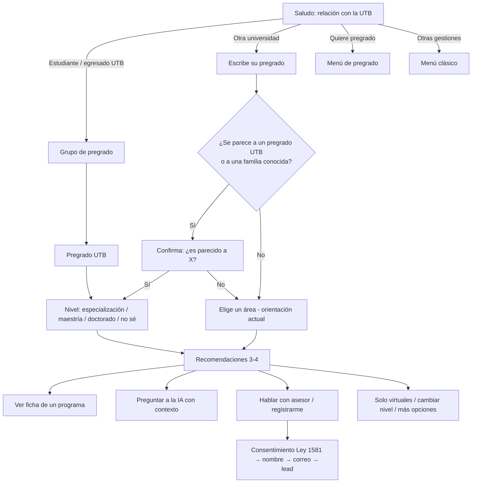

# Flujo de recomendación de posgrados según el pregrado

Rama: `nuevo-flujo`. Estado: **aprobado el 2026-10-28**; la tabla queda sujeta a la revisión de Posgrados UTB.

## Objetivo

Que cualquier persona que le escriba al bot reciba, en pocos pasos, 3 o 4
posgrados de la UTB que encajen con el pregrado que estudia o estudió, con el
porqué, el valor y el enlace oficial, y que desde ahí pueda pedir más
información a la IA o pasar a un asesor.

## Decisiones tomadas

| Tema | Decisión |
|---|---|
| Entrada | Es el **flujo predeterminado**: lo primero que ve quien escribe al bot. |
| Público | Estudiantes y egresados UTB **y** personas de otras universidades. |
| Datos personales | **Al final**, solo si la persona quiere asesor o registrarse. Recomendar no pide nada. |
| Motor | **Tabla curada** pregrado → posgrados (predecible y probada). La IA solo explica después. |

## Entrada y ruteo

El nuevo flujo reemplaza el saludo raíz (`sendMenu`, paso `menu`). Así, todo lo
que hoy manda a la raíz (el comando *menu*, el *0* en los menús, una sesión
vencida o un paso desconocido) llega al nuevo saludo sin tocar cada flujo.

El primer mensaje pregunta la relación con la UTB y, además, saca de inmediato
a quien no busca posgrado:

| Opción | Va a |
|---|---|
| 🎓 Estudio un pregrado en la UTB | Elegir pregrado UTB |
| 🎓 Soy egresado(a) de la UTB | Elegir pregrado UTB |
| 🏛️ Estudié en otra universidad | Escribir su pregrado |
| 🏫 Quiero estudiar un pregrado | Menú de pregrado actual (`menu_pregrado`) |
| 📋 Otras gestiones | Menú clásico Pregrado / Posgrado (notas, recibo, turno, asesor…) |

La campaña de posgrados (`POSGRADOS_EVENTO_ACTIVO`) conserva su prioridad en
`inboundProcessor`: si está activa, sigue atendiendo antes que este flujo.

## Pasos

1. **Relación** (`reco_relacion`): lista de la tabla anterior. Se guarda
   `relacion = estudiante_utb | egresado_utb | externo`.
2. **Grupo de pregrado** (`reco_pregrado_grupo`, solo UTB): 4 grupos para que
   ninguna lista pase de 10 filas — Ingenierías (10), Arquitectura y Diseño (2),
   Transformación Digital (4) y Negocios, Leyes y Sociedad (8, incluye
   Contaduría Pública Virtual). En cualquier momento puede escribir el nombre
   del pregrado en vez de elegir.
3. **Pregrado** (`reco_pregrado`): lista del grupo. Se guarda `pregradoId`.
4. **Pregrado externo** (`reco_pregrado_externo`): texto libre. Se busca en este
   orden: pregrado UTB parecido (con sinónimos: *informática* → Sistemas,
   *contador* → Contaduría, *abogado* → Derecho…), luego una familia externa
   (salud, educación, ciencias básicas, humanidades y turismo). Siempre se
   confirma: *“¿Tu pregrado es parecido a Ingeniería Industrial?”*. Si no hay
   coincidencia o dice que no, pasa a la orientación por áreas que ya existe.
5. **Nivel** (`reco_nivel`): Especialización, Maestría, Doctorado o *Aún no
   sé*. *Aún no sé* no filtra.
6. **Recomendaciones** (`reco_resultados`): 3 o 4 programas numerados con nombre,
   modalidad, valor 2026, por qué encaja y enlace oficial. A egresados UTB se
   les recuerda que hay beneficios para egresados (*consultar condiciones*,
   como ya dice la base de conocimiento). Acciones: ver la ficha de 1–4,
   preguntar a la IA, hablar con asesor, solo virtuales, cambiar nivel, más
   opciones, menú.
7. **Ficha** (`reco_ficha`): versión corta para WhatsApp de `fichaPrograma`
   (modalidad, duración, valor, título, 2–3 líneas de descripción, plan de
   estudios resumido y enlace).
8. **IA**: pasa a `chatting_with_ai` (área posgrados) con el contexto
   *“Pregrado: Ingeniería Industrial (egresado UTB). Recomendados: …”*, igual que
   hoy hace `resumenOrientacion`.
9. **Asesor / registro**: consentimiento (Ley 1581) → nombre → correo → se crea
   la conversación en Chatwoot (como `prospecto`) y el lead en Sheets/HubSpot
   con relación, pregrado, nivel y programas recomendados.

Comandos globales en todos los pasos: *menu* (vuelve al saludo), *0* (un paso
atrás), *asesor*.

## Motor de recomendación

Tabla curada en código (`src/flows/recomendacionPregrado.ts`, pura y probada).
Cada pregrado tiene tres listas ordenadas por prioridad:

- **Profundiza**: continuidad directa de la carrera.
- **Complementa**: gestión o perfil transversal que suele buscar esa carrera.
- **Investiga**: ruta de investigación (Maestría en Ingeniería, doctorados).

Selección (máximo 4):

1. Se aplican los filtros de nivel y, si la pidió, de modalidad virtual.
2. Se toman hasta 2 de *Profundiza*, 1 de *Complementa* y 1 de *Investiga*.
   Si una lista se queda sin programas tras filtrar, el cupo pasa a la
   siguiente.
3. Si quedan menos de 2, se relaja primero la modalidad y luego el nivel, y el
   mensaje lo dice (*“no hay maestrías virtuales para tu perfil; te muestro
   las presenciales”*).
4. *Más opciones* muestra el resto de la tabla del pregrado.

Reglas de la tabla, verificadas por pruebas: todo `id` existe en el catálogo
vigente, ningún pregrado repite un programa, cada pregrado tiene al menos 2
en *Profundiza* y ningún texto promete admisión ni empleo.

### Tabla para pregrados UTB

Nombres cortos; `(v)` = UTB Virtual. Los IDs exactos van en el código.

| Pregrado | Profundiza | Complementa | Investiga |
|---|---|---|---|
| Ingeniería Civil | Esp. Análisis y Diseño Estructural · Esp. Geotecnia Vial y Pavimentos | Esp. Gerencia de Proyectos · Maestría en Gerencia de Proyectos · Esp. Gestión Territorial y Derecho Urbano | Maestría en Ingeniería · Doctorado en Ingeniería |
| Arquitectura | Esp. Gestión Territorial y Derecho Urbano · Maestría en Gestión del Patrimonio y Turismo Cultural | Esp. Gerencia de Proyectos · Maestría en Gerencia de Proyectos | Doctorado en Desarrollo Regional y Local · Doctorado en Sostenibilidad |
| Diseño | Maestría en Gestión de la Innovación · Esp. Gestión Cultural Sostenible | Esp. Gerencia de Mercadeo · Esp. Gestión de Tecnologías Disruptivas · Esp. Gerencia de Proyectos | — |
| Ingeniería Industrial | Esp. Gerencia de Producción y Calidad · Esp. Gestión Logística y Cadena de Suministro · Maestría en Gerencia de Proyectos | MBA · Esp. Gerencia de la SST · Maestría en Gestión de la Innovación | Maestría en Ingeniería · Doctorado en Ingeniería |
| Ingeniería Ambiental | Esp. Gestión Ambiental Sostenible · Esp. Sistemas Energéticos Sostenibles | Esp. Gerencia de la SST · Esp. Gerencia de Proyectos | Doctorado en Sostenibilidad · Maestría en Ingeniería |
| Ingeniería Química | Esp. Gerencia de Producción y Calidad · Esp. Gestión Ambiental Sostenible · Esp. Sistemas Energéticos Sostenibles | Esp. Gerencia de la SST · Esp. Gerencia de Proyectos | Maestría en Ingeniería · Doctorado en Ingeniería |
| Ingeniería Naval | Esp. Gerencia de Mantenimiento · Maestría en Gerencia de Mantenimiento | Esp. Gestión Logística y Cadena de Suministro · Esp. Gerencia de Proyectos | Maestría en Ingeniería · Doctorado en Ingeniería |
| Ingeniería Mecánica | Esp. Gerencia de Mantenimiento · Maestría en Gerencia de Mantenimiento · Esp. Sistemas Energéticos Sostenibles · Esp. Automatización y Control | Esp. Gerencia de Producción y Calidad · Esp. Gerencia de Proyectos | Maestría en Ingeniería · Doctorado en Ingeniería |
| Ingeniería Eléctrica | Esp. Sistemas Energéticos Sostenibles · Esp. Automatización y Control · Maestría en Industria 4.0 | Esp. Gerencia de Mantenimiento · Esp. Gerencia de Proyectos | Maestría en Ingeniería · Doctorado en Ingeniería |
| Ingeniería Electrónica | Esp. Automatización y Control · Maestría en Industria 4.0 · Esp. Telecomunicaciones y Redes | Maestría en Ciberseguridad · Esp. Gerencia de Proyectos | Maestría en Ingeniería · Doctorado en Ingeniería |
| Ingeniería Mecatrónica | Maestría en Industria 4.0 · Esp. Automatización y Control | Esp. Gerencia de Mantenimiento · Esp. Gerencia de Proyectos | Maestría en Ingeniería · Doctorado en Ingeniería |
| Ingeniería Biomédica | Esp. Gerencia de Servicios de Salud (v) · Esp. Gerencia de Mantenimiento | Esp. Gerencia de Proyectos · Maestría en Gestión de la Innovación | Maestría en Ingeniería · Doctorado en Ingeniería |
| Ingeniería de Sistemas y Computación | Esp. Ingeniería de Software (v) · Maestría en Ciberseguridad · Maestría en Estadística Aplicada y Ciencia de Datos · Esp. Telecomunicaciones y Redes | Maestría en Management de la Transformación Digital · Esp. Gerencia de Proyectos | Maestría en Ingeniería · Doctorado en Ingeniería |
| Ciencia de Datos | Maestría en Estadística Aplicada y Ciencia de Datos · Esp. Estadística Aplicada | Maestría en Ciberseguridad · Maestría en Management de la Transformación Digital · Esp. Gestión de Tecnologías Disruptivas | Maestría en Ingeniería |
| Marketing y Transformación Digital | Esp. Gerencia de Mercadeo · Maestría en Management de la Transformación Digital · Esp. Gestión de Tecnologías Disruptivas | MBA · Esp. Gestión de Negocios Internacionales | Doctorado en Administración |
| Comunicación Social | Esp. Gestión Cultural Sostenible · Maestría en Gestión del Patrimonio y Turismo Cultural · Esp. Gerencia de Mercadeo | Maestría en Management de la Transformación Digital · Maestría en Métodos de Investigación Social | Doctorado en Desarrollo Regional y Local |
| Administración de Empresas | MBA · Esp. Gerencia Empresarial · Esp. Planeación Estratégica y Prospectiva · Esp. Gerencia del Talento Humano | Esp. Gerencia de Proyectos · Esp. Gerencia de Mercadeo · Maestría en Gestión Humana y Desarrollo Organizacional | Doctorado en Administración |
| Finanzas y Negocios Internacionales | Maestría en Finanzas · Esp. Finanzas · Esp. Gestión de Negocios Internacionales · Maestría en Negocios Internacionales e Integración | MBA · Esp. Gestión Logística y Cadena de Suministro | Doctorado en Administración |
| Contaduría Pública (y virtual) | Esp. Estándares Internacionales de Contabilidad y Auditoría · Esp. Gerencia Tributaria · Maestría en Gerencia Tributaria | Esp. Finanzas · Maestría en Finanzas | Doctorado en Administración |
| Derecho | Maestría en Derecho · Esp. Derecho Comercial · Esp. Derecho del Trabajo y Relaciones Laborales · Esp. Contratación Estatal (v) · Esp. Derechos Humanos (v) | Esp. Gestión Territorial y Derecho Urbano · Esp. Gerencia Tributaria | Doctorado en Desarrollo Regional y Local |
| Psicología | Maestría en Intervención Psicosocial · Esp. Gerencia del Talento Humano · Maestría en Gestión Humana y Desarrollo Organizacional | Esp. Gerencia de la SST · Maestría en Educación · Maestría en Métodos de Investigación Social | Doctorado en Desarrollo Regional y Local |
| Economía | Maestría en Finanzas · Maestría en Estadística Aplicada y Ciencia de Datos · Esp. Estadística Aplicada · Maestría en Negocios Internacionales e Integración | Esp. Planeación Estratégica y Prospectiva · Esp. Gerencia Tributaria | Doctorado en Desarrollo Regional y Local · Doctorado en Administración |
| Ciencia Política y Relaciones Internacionales | Esp. Derechos Humanos (v) · Maestría en Negocios Internacionales e Integración · Esp. Gestión de Negocios Internacionales · Esp. Contratación Estatal (v) | Maestría en Métodos de Investigación Social · Esp. Planeación Estratégica y Prospectiva · Esp. Gestión Territorial y Derecho Urbano | Doctorado en Desarrollo Regional y Local |

### Familias para pregrados de otras universidades

Si el pregrado externo no se parece a uno de la UTB, se busca su familia por
palabras clave:

| Familia | Palabras clave (ejemplos) | Profundiza | Complementa | Investiga |
|---|---|---|---|---|
| Salud | medicina, enfermería, odontología, bacteriología, fisioterapia, nutrición, instrumentación | Esp. Gerencia de Servicios de Salud (v) · Esp. Gerencia de la SST (presencial y v) | MBA · Esp. Gerencia de Proyectos | — |
| Educación | licenciatura, pedagogía, docente, educación | Maestría en Educación · Maestría en Educación Mediada por las TIC (v) · Esp. Educación Mediada por las TIC (v) · Esp. Dirección de Instituciones Educativas · Maestría en Enseñanza de las Matemáticas y Ciencias Naturales | Maestría en Métodos de Investigación Social | Doctorado en Desarrollo Regional y Local |
| Ciencias básicas | matemáticas, física, química, biología, estadística | Maestría en Estadística Aplicada y Ciencia de Datos · Esp. Estadística Aplicada · Maestría en Enseñanza de las Matemáticas y Ciencias Naturales | Esp. Gestión Ambiental Sostenible | Maestría en Ingeniería · Doctorado en Sostenibilidad |
| Humanidades y turismo | historia, filosofía, artes, música, turismo, hotelería, trabajo social, sociología | Maestría en Gestión del Patrimonio y Turismo Cultural · Esp. Gestión Cultural Sostenible | Maestría en Métodos de Investigación Social · Maestría en Intervención Psicosocial | Doctorado en Desarrollo Regional y Local |

Lo que no encaje en nada (agronomía, veterinaria, etc.) va a la orientación
por áreas que ya existe, en vez de forzar una recomendación.

## Datos y privacidad

- Recomendar no pide datos personales. En sesión solo quedan relación,
  pregrado (ID o texto escrito), nivel y los IDs recomendados.
- Al pedir asesor o registrarse: consentimiento explícito (Ley 1581 de 2012,
  mismo texto que el flujo de evento), luego nombre y correo.
- El lead lleva relación, pregrado, nivel y programas recomendados, para que
  el asesor no tenga que volver a preguntar.

## Métricas

Eventos nuevos (hay que agregarlos a `metricEventAllowlist.ts`):
`reco_inicio`, `reco_relacion_estudiante_utb`, `reco_relacion_egresado_utb`,
`reco_relacion_externo`, `reco_pregrado_utb`, `reco_externo_coincide`,
`reco_externo_sin_coincidencia`, `reco_resultados`, `reco_ficha`, `reco_ia`,
`reco_asesor`, `reco_lead_completado`, `reco_salida_pregrado`,
`reco_salida_otras_gestiones`.

Con eso se puede ver el embudo: cuántos llegan a ver recomendaciones y cuántos
terminan pidiendo asesor.

## Implementación (un commit por paso)

1. **Motor**: `recomendacionPregrado.ts` con la tabla, las familias externas,
   la búsqueda del pregrado escrito y la selección con filtros. Solo funciones
   puras y pruebas.
2. **Pasos del flujo**: relación, grupo, pregrado, pregrado externo con
   confirmación, nivel y resultados, con sus handlers y pruebas de los textos
   (largo de WhatsApp, enlaces, sin promesas).
3. **Flujo predeterminado**: el saludo raíz pasa a ser el de este flujo; el
   menú Pregrado / Posgrado queda como *Otras gestiones*.
4. **Cierre**: ficha corta, IA con contexto del pregrado, asesor con
   consentimiento y lead (Chatwoot + Sheets/HubSpot) y métricas.

## Por validar con la UTB

- Que la tabla de arriba refleje lo que Posgrados quiere recomendar a cada
  carrera (es el punto más importante).
- Las condiciones del beneficio para egresados, para poder decirlas con
  precisión en vez de *“consultar condiciones”*.
- Si a estudiantes de últimos semestres se les puede ofrecer algo especial
  (por ejemplo, cursar materias de posgrado como opción de grado).
